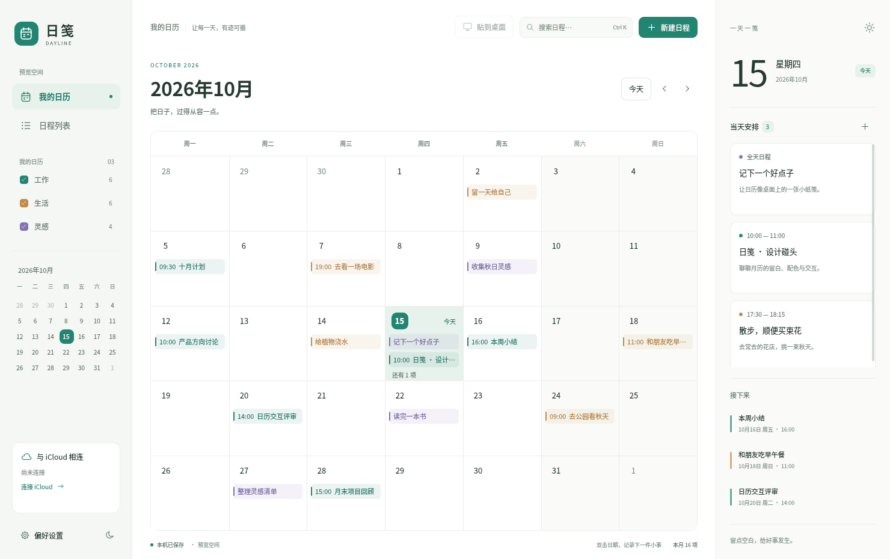
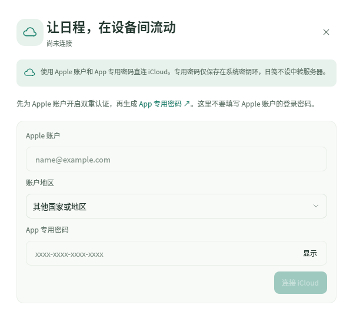

# 日笺 Dayline

一个给 Linux 桌面用的日历。把月历放在桌面上，双击日期记事，也可以打开窗口整理日程、连接 iCloud。

C++ / Qt Quick 编写，使用系统 Qt 运行库，安装包不捆绑浏览器引擎。



*截图来自独立的示例日历，不含真实账户或个人日程。*

[下载安装包](https://github.com/noxmew/dayline/releases/latest) · [反馈问题](https://github.com/noxmew/dayline/issues)

## 现在能做什么

- 月历、日程列表、搜索和当天安排；支持全天日程、时间段和备注。
- 本机提供「工作」「生活」「灵感」三个日历，可以分别显示或隐藏。
- 半透明桌面月历，支持移动、调整大小、锁定位置和深浅色外观。
- 已接入 iCloud CalDAV：选择同步日历、读写普通日程、保存离线修改、处理同步冲突。真实 Apple 账户的跨设备往返还未完成验证。

日笺目前是预览版。重复日程和会议邀请等复杂内容保留原文，以只读方式处理；暂不支持新建重复日程和本机提醒。

## 安装

当前提供 **Ubuntu 24.04** 的 `.deb`，下载时按系统架构选择：

| 架构 | 对应设备 |
| --- | --- |
| `amd64` | Intel / AMD 的 64 位电脑 |
| `arm64` | ARM 64 位电脑 |

不确定时，运行 `dpkg --print-architecture` 查看。在[最新版本](https://github.com/noxmew/dayline/releases/latest)下载对应安装包，然后到下载目录执行，将文件名换成实际下载的文件名：

```bash
sudo apt install ./dayline_版本号_ubuntu24.04_amd64.deb
```

Qt 等依赖由系统包管理器安装。装好后，在应用菜单打开「日笺」，或运行：

```bash
dayline
```

想先看示例，可以运行 `dayline --demo`。示例日历使用独立的数据和设置。

**统信 UOS / DDE 是后续适配目标，尚未完成实机验证。** 当前安装包依赖 Ubuntu 24.04 的运行库，不能据此认为能直接装到 UOS。

## 放到桌面上

在主窗口点击「贴到桌面」，或运行 `dayline --desktop`。月历初始位置贴齐屏幕可用区域的右上角，普通应用窗口可以盖在它上面。

- 双击日期新建日程，单击已有日程编辑。
- 点击右上角的锁按钮解锁后，拖动标题区或底栏移动；拖动右下角调整大小。
- 齿轮菜单里可以调整背景透明度、切换深色外观、重置大小与位置。
- 「打开日历窗口」可以回到完整界面；「返回窗口模式」会收起桌面月历。

桌面模式使用 X11 / XWayland 的桌面窗口协议，效果取决于桌面环境。目前在 Ubuntu 的 GNOME 46 Wayland 会话验证过。

**GNOME Wayland 用户：** 安装包附带 `Dayline Desktop Bridge` 扩展，用来让月历接收点击，并保持在普通窗口下面。首次安装后重新登录桌面，再到日笺「偏好设置」点击「启用桌面桥」。扩展目前仅声明支持 GNOME Shell 46；其他版本尚未验证。

## 连接 iCloud



1. 在 Apple 账户中开启双重认证，并前往 [Apple 账户管理](https://account.apple.com/account/manage)生成 **App 专用密码**。
2. 打开日笺左下角「连接 iCloud」，或在「偏好设置」进入「iCloud 账户与同步」。
3. 填写 Apple 账户、账户地区和 App 专用密码。中国大陆账户选择「中国大陆（云上贵州）」。
4. 连接后选择需要同步的日历。新建日程时，在「日历」中选择对应的 iCloud 日历。

日笺直接连接 iCloud，没有中转服务器。专用密码保存在系统密钥环中，需要桌面提供可用且已解锁的 **Secret Service**（例如 GNOME Keyring）。这里填写的是 App 专用密码，不是 Apple 账户的登录密码。

连接后每 60 秒同步，也可点击「立即同步」。离线修改先留在本机，恢复连接后再上传；同一项日程在两端被修改时，可以选择采用云端、保留本机或另存为新日程。本机的三个分类日历不会自动上传到 iCloud。

## 从源码构建

需要 C++20、CMake 3.21 或更新版本、Qt 6.4 或更新版本，以及 libical、xcb。以下命令适用于 Ubuntu 24.04：

```bash
sudo apt update
sudo apt install --no-install-recommends \
  build-essential cmake ninja-build pkg-config libxcb1-dev libical-dev \
  qt6-base-dev qt6-declarative-dev qt6-declarative-dev-tools \
  qt6-qpa-plugins libqt6sql6-sqlite \
  qml6-module-qtqml qml6-module-qtqml-models qml6-module-qtqml-workerscript \
  qml6-module-qtquick qml6-module-qtquick-controls qml6-module-qtquick-layouts \
  qml6-module-qtquick-window qml6-module-qtquick-templates

git clone https://github.com/noxmew/dayline.git
cd dayline
cmake -S . -B build -G Ninja -DCMAKE_BUILD_TYPE=Release
cmake --build build --parallel 4
./build/dayline --demo
```

打包为 `.deb`：

```bash
cpack --config build/CPackConfig.cmake -B dist
```

GitHub Actions 会在每次推送到 `main` 后，分别构建 amd64 和 arm64 安装包并发布到 Releases。版本号采用 `0.1.构建序号`，随新的推送递增。

## 许可证

[MIT](LICENSE)。
